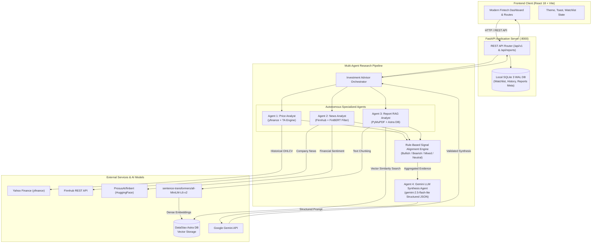

# AgentVest: An LLM-Based Multi-Agent Stock Analysis & Investment Advisor

[](https://fastapi.tiangolo.com)
[](https://react.dev)
[](https://python.org)
[](https://huggingface.co/ProsusAI/finbert)
[](https://deepmind.google/technologies/gemini/)
[](https://www.datastax.com/products/datastax-astra)
[](https://sqlite.org)
[](https://docs.pytest.org)

**AgentVest** is an enterprise-grade, multi-agent financial research and investment synthesis platform designed for B.Tech major projects, technical interviews, and portfolio demonstrations. It integrates quantitative price action, deep-learning financial news sentiment, grounded Retrieval-Augmented Generation (RAG) over corporate 10-K/10-Q SEC PDF filings, and multi-agent synthesis via Google Gemini to provide transparent, multi-perspective investment intelligence.

---

## 📑 Table of Contents
1. [Problem Statement & Motivation](#-problem-statement--motivation)
2. [Key Capabilities & Innovations](#-key-capabilities--innovations)
3. [Multi-Agent System Architecture](#-multi-agent-system-architecture)
4. [Technology Stack](#-technology-stack)
5. [Frontend Multi-Page Architecture](#-frontend-multi-page-architecture)
6. [Backend & Data Engineering](#-backend--data-engineering)
7. [Installation & Setup (Windows PowerShell)](#-installation--setup-windows-powershell)
8. [Configuration & Environment Variables](#-configuration--environment-variables)
9. [Comprehensive REST API Reference](#-comprehensive-rest-api-reference)
10. [End-to-End 20-Step Demonstration Walkthrough](#-end-to-end-20-step-demonstration-walkthrough)
11. [Testing & Verification](#-testing--verification)
12. [Academic Disclaimers & Responsible AI](#-academic-disclaimers--responsible-ai)

---

## 🎯 Problem Statement & Motivation

Modern retail investors and research analysts face three critical challenges:
1. **Information Fragmentation**: Quantitative price charts, technical momentum oscillators, high-frequency news feeds, and dense 100+ page SEC filings exist in disparate silos.
2. **Hallucination Risk in Financial LLMs**: General-purpose LLMs generate convincing yet fictitious financial metrics, invent past earnings figures, and hallucinate market rumors when answering ungrounded queries.
3. **News Ticker Contamination**: Financial news aggregators often tag mega-cap companies (e.g., Apple `AAPL`) in market-wide roundups, polluting ticker sentiment with unrelated company developments (e.g., Tesla, Dell, Coca-Cola).

**AgentVest** addresses these challenges through a **modular, multi-agent pipeline**:
- Dedicated quantitative agents handle mathematical calculations with zero hallucination.
- Specialized NLP pipelines (`ProsusAI/finbert`) classify news sentiment with domain-specific tokenization.
- A semantic RAG vector database (DataStax Astra DB) indexes corporate PDF reports with strict page-level citation boundaries.
- An Investment Advisor Agent cross-examines agreement, conflicting signals, and evidence gaps before synthesizing an executive verdict via Google Gemini.

---

## ⚡ Key Capabilities & Innovations

- **Multi-Agent Orchestration**: Discrete agent responsibilities for Price, News, SEC Filings, and Rule-Based Signal Synthesis with graceful degradation if any external service experiences an outage.
- **Ticker & Entity Relevance Filtering**: High-precision regex token boundaries and company name matching filter out noisy market roundups and cross-ticker false positives.
- **SEC 10-K/10-Q PDF RAG Pipeline**: High-fidelity text extraction via PyMuPDF, recursive sentence-aware chunking (preserving page numbers), 384-dimensional dense vector embeddings (`all-MiniLM-L6-v2`), and cosine vector search on DataStax Astra DB.
- **Grounded Gemini Synthesis**: Gemini structured JSON output schema strictly maps supporting evidence, conflicting signals, key investment risks, and missing data gaps.
- **Zero-Setup Application Persistence**: Integrated SQLite 3 database operating in WAL (Write-Ahead Logging) mode manages user watchlists, uploaded report catalogs, and historical research sessions without requiring an external database cluster.
- **Fintech UI/UX**: Professional dark navy fintech theme, interactive SVG charts, OHLCV inspector strip, Wilder RSI(14), MACD(12,26,9), and Bollinger Bands (\(\pm 2\sigma\)).

---

## 🏛 Multi-Agent System Architecture



---

## 🛠 Technology Stack

### Frontend
- **Framework**: React 18 with Vite build tooling
- **Routing**: React Router v7 (`react-router-dom`)
- **Icons**: Lucide React (`lucide-react`)
- **Styling**: Pure semantic modern fintech CSS (zero external UI bloat, dark/light theme tokens, responsive flex/grid layouts)
- **Visualizations**: Interactive SVG candlestick/line charts, technical indicator overlays, and sentiment breakdown bars

### Backend
- **Framework**: FastAPI 0.115+ (Asynchronous Python REST API)
- **Server**: Uvicorn ASGI
- **Data Validation**: Pydantic v2
- **Persistence**: SQLite 3 (Thread-safe connection pool with WAL mode)
- **Data Science**: NumPy, Pandas

### AI, Machine Learning & NLP
- **LLM Synthesis**: Google Gemini 2.5 Flash Lite via official `google-genai` SDK
- **Sentiment Classification**: `ProsusAI/finbert` (Financial BERT via HuggingFace Transformers & PyTorch)
- **Dense Vector Embeddings**: `sentence-transformers/all-MiniLM-L6-v2` (384-dimensional cosine similarity)
- **Document Processing**: PyMuPDF (`fitz`) with page-number boundary tracking
- **Vector Database**: DataStax Astra DB Serverless Vector Search (`astrapy`)

---

## 🌐 Frontend Multi-Page Architecture

AgentVest features 8 canonical routes managed by a persistent collapsible sidebar and responsive top navigation:

| Route | Page | Core Purpose |
|:---|:---|:---|
| `/` | **Overview Dashboard** | Real-time market summary, live stock KPI snapshot, 1-year historical chart preview, news sentiment preview, quick watchlist summary, and system health status. |
| `/stocks` | **Advanced Stock Analysis** | Deep quantitative analysis with dynamic lookback (`6mo`, `1y`, `2y`, `5y`), interactive OHLCV strip on hover, SMA 20/50, EMA 20, Bollinger Bands (\(\pm 2\sigma\)), Wilder RSI(14), and MACD. |
| `/news` | **News Intelligence** | Ticker-specific Finnhub news with strict entity filtering (eliminates AAPL competitor noise), FinBERT sentiment scores, aggregate sentiment score, and distribution chart. |
| `/reports` | **Financial Report Research** | Drag-and-drop SEC PDF upload, real-time chunking progress, Astra DB vector indexing, report selector catalog, and citation-grounded RAG query answering. |
| `/advisor` | **Multi-Agent AI Advisor** | Flagship multi-agent hub. Runs the 4-stage pipeline (Price, News, Report RAG, Gemini synthesis), displays agent execution status, signal alignment, and executive risks. |
| `/watchlist` | **Watchlist** | SQLite-persisted stock watchlist with ticker validation, real-time price & trend badges, one-click analysis launch, and deletion. |
| `/history` | **Research History** | SQLite-persisted log of completed multi-agent runs with ticker search, date filters, research summaries, and full drawer view. |
| `/settings` | **Settings & Diagnostics** | Configurable research lookbacks, theme selector (Dark Fintech / Light), model specifications, and live diagnostic monitoring of all 7 backend subsystems. |

---

## ⚙ Backend & Data Engineering

### 1. Robust News Relevance Filtering
To resolve the common issue where Apple (`AAPL`) queries return articles primarily about Tesla, Dell, or Coca-Cola, `backend/app/services/news_data.py` employs a multi-stage scoring filter:
- **Token Boundaries**: Matches exact word boundaries `\bAAPL\b` to prevent partial matches.
- **Entity Matching**: Scores presence of primary company entities (`Apple`, `iPhone`, `iPad`, `MacBook`, `Tim Cook`, `Cupertino`).
- **Competitor Penalties**: Penalizes articles where competitor tokens (Tesla, Dell, Coca-Cola) dominate the headline without Apple in the primary subject position.
- **Headline Deduplication**: Normalizes headlines using alphanumeric token hashing to purge duplicate wire syndicated stories.

### 2. Thread-Safe SQLite Persistence Layer
Relational metadata is managed in `backend/data/agentvest.db` using WAL mode (`PRAGMA journal_mode=WAL`):
- `watchlist`: Stores saved stock symbols and timestamps.
- `reports_meta`: Catalogs uploaded PDF files, chunk counts, page counts, and indexing timestamps.
- `research_history`: Stores completed multi-agent advisor analyses, signals, and Gemini synthesis output for immediate retrieval.

---

## 🚀 Installation & Setup (Windows PowerShell)

### Prerequisites
- **Python**: 3.11+ installed and added to `PATH`
- **Node.js**: 18+ and `npm` installed
- **Git**: Installed

### 1. Clone & Open the Repository
```powershell
cd "c:\Users\Nishath Tabassum\Downloads\AgentVest_Phase3_Complete\AgentVest"
```

### 2. Backend Setup
```powershell
# Navigate to backend directory
cd backend

# Create Python virtual environment
py -3.11 -m venv .venv

# Activate virtual environment
.\.venv\Scripts\Activate.ps1

# Upgrade pip and install dependencies
python -m pip install --upgrade pip
pip install -r requirements.txt

# Configure environment variables
Copy-Item .env.example .env
# Open .env and insert your API keys (Finnhub, Gemini, Astra DB)

# Run FastAPI backend with hot-reload
python -m uvicorn app.main:app --host 127.0.0.1 --port 8000 --reload
```
*Backend API Swagger Docs will be live at `http://127.0.0.1:8000/docs`.*

### 3. Frontend Setup (in a separate terminal)
```powershell
# Navigate to frontend directory
cd frontend

# Install Node dependencies
npm install

# Configure frontend environment variables
Copy-Item .env.example .env

# Start Vite development server
npm run dev
```
*Frontend UI will be live at `http://localhost:5173`.*

---

## 🔑 Configuration & Environment Variables

Create a `.env` file in the `backend/` directory based on `.env.example`:

| Environment Variable | Required | Description | Example / Default |
|:---|:---:|:---|:---|
| `ENVIRONMENT` | Yes | Application environment | `development` / `production` |
| `APP_NAME` | No | FastAPI application name | `AgentVest` |
| `FINNHUB_API_KEY` | Optional | Finnhub API Key for live news feeds | `c...` |
| `GEMINI_API_KEY` | Optional | Google AI Studio Key for Gemini synthesis | `AIzaSy...` |
| `GEMINI_MODEL` | No | Google Gemini model identifier | `gemini-2.5-flash-lite` |
| `ASTRA_DB_API_ENDPOINT` | Optional | DataStax Astra DB Vector API Endpoint | `https://<id>-<region>.apps.astra.datastax.com` |
| `ASTRA_DB_APPLICATION_TOKEN` | Optional | DataStax Astra DB Application Token | `AstraCS:...` |
| `ASTRA_DB_KEYSPACE` | No | Astra DB keyspace name | `default_keyspace` |
| `ASTRA_DB_COLLECTION` | No | Astra DB vector collection name | `financial_reports` |

> [!NOTE]
> All external API integrations degrade gracefully. If Finnhub or Gemini keys are missing, the system informs the user and continues to serve quantitative technical analysis, local FinBERT sentiment analysis, and rule-based advice.

---

## 📡 Comprehensive REST API Reference

### Health & Diagnostics
- `GET /health` — Simple health check returning service name and status.
- `GET /api/v1/system/status` — Live diagnostics of all 7 backend subsystems (`yfinance`, `finnhub`, `finbert`, `astra_db`, `gemini`, `embeddings`, `sqlite`) with secret masking.

### Stock Analysis
- `GET /api/v1/stocks/{symbol}?period={period}` — Fetch historical OHLCV data, compute returns, volatility, SMA 20/50, EMA 20, RSI(14), MACD, and Bollinger Bands.

### News Intelligence
- `GET /api/v1/news/{symbol}?days={days}` — Fetch company news, execute regex relevance filtering and FinBERT sentiment inference, and calculate aggregate sentiment.

### Financial Reports & RAG
- `POST /api/reports/upload` — Upload SEC PDF filing, extract text with PyMuPDF, chunk, generate embeddings, and index into Astra DB.
- `POST /api/reports/ask` — Semantic question answering over uploaded reports with cosine similarity retrieval and page citations.
- `GET /api/reports/list?ticker={ticker}` — List indexed report metadata from SQLite catalog.
- `GET /api/reports/{report_id}` — Get specific report metadata by ID.

### Multi-Agent Investment Advisor
- `GET /api/v1/advisor/{symbol}?period=1y&days=7&include_report=true&include_synthesis=true&report_id={id}` — Flagship multi-agent endpoint coordinating Price, News, Report RAG, and Gemini synthesis agents.

### Watchlist Management (SQLite)
- `GET /api/v1/watchlist` — Retrieve saved stock symbols with latest price preview.
- `POST /api/v1/watchlist` — Add validated stock symbol (`{"symbol": "AAPL"}`).
- `DELETE /api/v1/watchlist/{symbol}` — Remove symbol from watchlist.

### Research History (SQLite)
- `GET /api/v1/history?ticker={ticker}` — Retrieve saved multi-agent research runs.
- `POST /api/v1/history` — Save completed research session.
- `GET /api/v1/history/{id}` — Retrieve detailed research session.
- `DELETE /api/v1/history/{id}` — Delete research entry.

---

## 🎬 End-to-End 20-Step Demonstration Walkthrough

Follow this 20-step script for an academic project demonstration or technical interview:

1. **Launch AgentVest**: Open `http://localhost:5173` to see the Overview Dashboard.
2. **Review Dashboard KPIs**: Observe the real-time ticker summary for `AAPL`, market status, and live 1-year historical chart.
3. **Global Search**: Type `NVDA` in the Topbar search input and press Enter.
4. **Inspect Technicals**: On the **Stock Analysis** page (`/stocks`), switch periods between `6mo`, `1y`, `2y`, and `5y`.
5. **Hover OHLCV Inspector Strip**: Hover over the historical chart to see Open, High, Low, Close, and Volume dynamically rendered in the top inspector strip.
6. **Evaluate Indicators**: Scroll down to inspect the Wilder RSI(14) oscillator and MACD signal line crossovers.
7. **Navigate to News Intelligence**: Click **News Intelligence** (`/news`) in the sidebar.
8. **Verify Relevance Filtering**: Notice that all articles are strictly relevant to the target company, with competitor noise (e.g., unrelated Tesla/Dell articles) filtered out.
9. **Inspect FinBERT Sentiment**: Review the sentiment distribution bar (Positive vs. Neutral vs. Negative) and sentiment confidence badges.
10. **Open Financial Reports**: Click **Financial Reports** (`/reports`) in the sidebar.
11. **Upload a 10-K/10-Q PDF**: Drag and drop an SEC financial filing PDF into the upload zone.
12. **Monitor Ingestion**: Watch the live progress indicator as text is parsed, chunked, embedded via `all-MiniLM-L6-v2`, and indexed in Astra DB.
13. **Ask a Grounded Question**: Enter a question such as *"What were the primary revenue drivers and capital expenditures this year?"*.
14. **Inspect Grounded Citations**: Review the generated answer with explicit page number citations from the source PDF.
15. **Open AI Investment Advisor**: Navigate to **AI Advisor** (`/advisor`) — the flagship feature.
16. **Configure Research Run**: Select `1y` price history, `7` days of news lookback, select the uploaded report from the catalog, and toggle **Enable Gemini AI Synthesis**.
17. **Run Multi-Agent Research**: Click **Run Multi-Agent Research** and observe the live 4-agent stepper tracking execution.
18. **Review Multi-Perspective Output**:
    - Quantitative Technical Outlook (Bullish/Bearish)
    - FinBERT News Sentiment (Positive/Neutral/Negative)
    - RAG Document Evidence
    - Google Gemini Executive Summary, Supporting Evidence, Conflicting Signals, and Key Risks.
19. **Add to Watchlist**: Click **Add to Watchlist**; navigate to `/watchlist` to verify SQLite persistence.
20. **Inspect Research History**: Navigate to `/history` to review the archived research session, filter by ticker, and verify data persists across page refreshes.

---

## 🧪 Testing & Verification

AgentVest includes comprehensive automated testing across both backend and frontend.

### Running Backend Tests
Execute pytest with the Python virtual environment activated:
```powershell
cd backend
.\.venv\Scripts\pytest.exe -v
```

**Results**: **50 of 50 tests passing** (100% pass rate in ~26s):
- `tests/test_api.py` (8 tests): Health check, indicators, response shape, symbol validation, system status diagnostics, and secret protection.
- `tests/test_investment_advisor.py` (10 tests): Multi-agent orchestration, report skip, news failure fault tolerance, and Gemini synthesis verification.
- `tests/test_news.py` (9 tests): Sentiment aggregation, exchange validation, Finnhub error handling, and AAPL relevance filtering.
- `tests/test_pdf_processor.py` (4 tests): Page extraction, chunking page-number preservation, overlap validation.
- `tests/test_reports_listing.py` (2 tests): Report catalog persistence and API listing.
- `tests/test_report_agent.py` (4 tests): Vector store query agent and edge cases.
- `tests/test_synthesis_agent.py` (8 tests): Gemini structured prompt generation, JSON schema validation, and graceful degradation.
- `tests/test_vector_store.py` (3 tests): Astra DB vector storage and retrieval.
- `tests/test_watchlist_history.py` (2 tests): SQLite Watchlist and History CRUD endpoints.

### Running Frontend Production Build
```powershell
cd frontend
npm run build
```
**Results**: Built cleanly in ~11s (`dist/` generated with zero compilation errors).

---

## ⚖ Academic Disclaimers & Responsible AI

1. **Non-Financial Advice**: AgentVest is designed strictly for academic, research, and technical demonstration purposes. It does not provide personalized investment advice or financial advisory services.
2. **Ungrounded Hallucination Prevention**: To prevent LLM hallucinations, Gemini synthesis is strictly constrained by retrieved document context and technical signals. If documents or indicators are absent, the system explicitly reports missing data rather than speculating.
3. **Market Data Limitations**: Market data obtained via Yahoo Finance may be delayed up to 15 minutes. Historical indicator momentum does not guarantee future financial returns.

---

**Developed for B.Tech Major Project Demonstration — AgentVest Multi-Agent Architecture**
